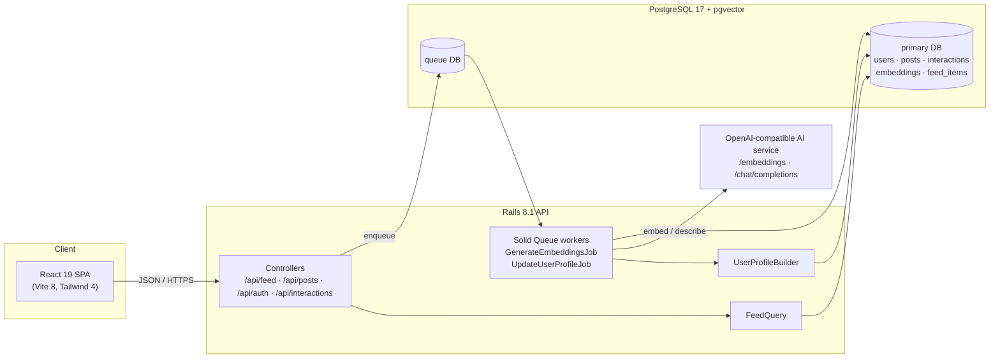

# Trends Display — Product Intent

| Field        | Value                                   |
|--------------|-----------------------------------------|
| Document     | Product intent / project foundation     |
| Status       | Draft — Proof of Concept (PoC)          |
| Version      | 0.1                                     |
| Owner        | Camilo C. Pacheco                       |
| Last updated | 2026-10-19                              |

---

## 1. Executive summary

Trends Display is a proof of concept for a **Pinterest-like visual discovery network**. Users browse a masonry feed of image and text posts, interact with the posts, and publish their own. Each interaction refines a **semantic profile** of the user, and the feed is re-ranked against that profile using vector embeddings from an external AI service.

The PoC is meant to test three things end to end:

1. A feed that feels like a modern visual discovery product: masonry layout, infinite scroll, fast first paint.
2. Behavioural signals (likes, saves, dwell time…) that measurably change what a user sees next.
3. A content pipeline in which every new post, text or image, is turned into embeddings without blocking the user.

The project runs on **Ruby on Rails 8.1 (API-only)** with **PostgreSQL 17 + pgvector**, a **React 19 + Vite 8 + TypeScript 6** single-page app, and an **OpenAI-compatible local AI service** that produces embeddings and image descriptions.

---

## 2. Problem statement and goals

### 2.1 Problem
Discovery products succeed when users see content that matches their tastes without having to search for it. Building that requires three parts working together: content ingestion, behavioural signal capture, and similarity-based ranking. The team needs a small, working reference implementation that shows those parts integrated on a modern Rails + React stack.

### 2.2 Goals
| ID  | Goal |
|-----|------|
| G-1 | Deliver a responsive masonry **feed** with cursor-based infinite scroll. |
| G-2 | **Personalise** the feed with cosine similarity between a user-profile vector and post embeddings, falling back to "newest first" for users with no signals. |
| G-3 | Capture **post interactions** (impression, open, dwell, like, save, share) and feed them back into the user profile asynchronously. |
| G-4 | Let authenticated users **create posts** with text and an optional image, provided by URL or file upload. |
| G-5 | Generate post **embeddings** (text + AI-generated image description) in background jobs. |
| G-6 | Provide **basic authentication** (email + password) so that interactions and posts belong to a real user. |

### 2.3 Non-goals (for this PoC)
- Production-grade scale, multi-region deployment or high availability.
- Content moderation, reporting or NSFW classification beyond what ingestion filters out.
- Social graph features: follows, boards/collections management, direct messages, notifications.
- Real-time updates (WebSockets / Action Cable) in the feed.
- Native mobile apps.
- OAuth / social login, password reset by email, MFA.

---

## 3. Stakeholders and personas

| Persona | Description | Primary needs |
|---------|-------------|---------------|
| **Browser** | Signed-in user who scrolls the feed for inspiration. | Fast feed, relevant content, low-friction interactions. |
| **Creator** | Signed-in user who publishes posts. | Simple post form, clear validation, the post shows up for others. |
| **PoC evaluator** | Product owner or engineer judging feasibility. | Visible personalisation effect, traceable signals, reproducible seed data. |
| **Developer** | Engineer extending the PoC. | Clear contracts, conventions, and a documented stack. |

---

## 4. Scope

### 4.1 In scope
| Pillar | Capabilities |
|--------|--------------|
| **Authentication** | Sign up, sign in, sign out. The authenticated user identifies the caller in every API request. |
| **Feed** | Personalised masonry feed, infinite scroll, cold-start fallback, loading/empty/error states. |
| **Post interaction** | Post detail view; impression, click/open, dwell `view`, like, save and share events; asynchronous profile update. |
| **Post creation** | Text (≤ 250 chars) plus an optional image, given as a URL **or** an uploaded file; asynchronous embedding generation. |

### 4.2 Future scope (already modelled, not exposed in the PoC UI)
| Item | Current state |
|------|---------------|
| `dislike`, `skip`, `comment`, `watch` events | Present in the `Interaction` enum and `UserProfileBuilder::WEIGHTS`. |
| Video / audio posts | `Embedding` enum reserves `video` and `audio`. `Post.media_type` only allows `image`. |
| Precomputed feeds | `feed_items` table exists (user, post, score, position). The current `FeedQuery` does not use it. |
| Comments UI and threads | Not modelled beyond the `comment` event type. |

---

## 5. Functional requirements

Priority uses MoSCoW: **M**ust, **S**hould, **C**ould, **W**on't (this PoC).

### 5.1 Authentication
| ID | Requirement | Priority |
|----|-------------|----------|
| FR-AUTH-01 | A visitor can sign up with `username`, `email` and `password`. Username and email must be unique, and the email must be valid. | M |
| FR-AUTH-02 | A registered user can sign in with email + password and receives a session credential usable by the SPA. | M |
| FR-AUTH-03 | A signed-in user can sign out, which invalidates the credential. | M |
| FR-AUTH-04 | The API identifies the current user from the credential. This **replaces** the temporary `user_id` query parameter used today by `GET /api/feed`. | M |
| FR-AUTH-05 | Creating posts and recording interactions require authentication. Unauthenticated requests receive `401`. | M |
| FR-AUTH-06 | Anonymous visitors can see the non-personalised (newest-first) feed. | S |
| FR-AUTH-07 | Passwords are stored only as a secure hash in `users.password_digest`. | M |

### 5.2 Feed
| ID | Requirement | Priority |
|----|-------------|----------|
| FR-FEED-01 | The feed renders posts in a **masonry grid** with responsive columns: 2 (< 768 px), 3 (≥ 768), 4 (≥ 1024), 5 (≥ 1280). | M |
| FR-FEED-02 | The feed loads pages through **opaque cursor pagination**. Default page size is 20, clamped to 1–50. | M |
| FR-FEED-03 | The next page is requested automatically when the user scrolls within ~800 px of the end of the list (infinite scroll). | M |
| FR-FEED-04 | For a user with a profile embedding, posts are ranked by **ascending cosine distance** between the profile vector and each post's text embedding. | M |
| FR-FEED-05 | For a user without a profile embedding, or an anonymous visitor, posts are shown **newest first**. | M |
| FR-FEED-06 | A user never sees their **own posts** in their feed. | M |
| FR-FEED-07 | When the ranked list runs out, the feed **wraps around** to the top so the experience stays continuous. The client removes posts it has already shown. | S |
| FR-FEED-08 | Image posts show the image with the text as caption. Text-only posts show the text on a gradient card. A broken image falls back to the text card. | M |
| FR-FEED-09 | The UI shows a skeleton on first load, "Loading more…" while paginating, "You're all caught up." at the end, "No posts yet." when empty, and an error with a **Retry** action. | M |
| FR-FEED-10 | Each card shows the author's `@username`. | M |

### 5.3 Post interaction
| ID | Requirement | Priority |
|----|-------------|----------|
| FR-INT-01 | Clicking a card opens a **post detail view** with the full image, full text, author and interaction controls. | M |
| FR-INT-02 | The client records an `impression` when a card becomes visible in the viewport (at most once per post per session). | S |
| FR-INT-03 | Opening the detail view records a `click`. | M |
| FR-INT-04 | Leaving the detail view records a `view` with `duration_ms` (dwell time). | M |
| FR-INT-05 | The user can **like** a post. | M |
| FR-INT-06 | The user can **save** a post. | M |
| FR-INT-07 | The user can **share** a post (copy link / Web Share API). The action is recorded as `share`. | S |
| FR-INT-08 | Interactions are sent to a dedicated endpoint (see §11.2). Sending must not block the UI, and failures must not break navigation. | M |
| FR-INT-09 | Every profile-affecting interaction enqueues an **asynchronous user-profile update** (`UpdateUserProfileJob`), with at most one concurrent update per user. | M |
| FR-INT-10 | Later feed requests reflect the updated profile. No page reload is needed beyond fetching the feed again. | S |

### 5.4 Post creation
| ID | Requirement | Priority |
|----|-------------|----------|
| FR-POST-01 | A signed-in user can open a **Create post** form. | M |
| FR-POST-02 | Text is required, with a maximum of **250 characters**. The form shows a live character counter. | M |
| FR-POST-03 | The user can optionally attach an image by **URL** (must be `http`/`https`). | M |
| FR-POST-04 | The user can optionally attach an image by **file upload** (JPEG, PNG, WebP, GIF). The file is stored server-side and served by URL. | M |
| FR-POST-05 | URL and upload are mutually exclusive for a single post. | M |
| FR-POST-06 | Validation errors from the API (`422` + `errors[]`) are shown inline. | M |
| FR-POST-07 | The image is previewed before submission. | S |
| FR-POST-08 | After creation, the system enqueues `GenerateEmbeddingsJob` to embed the text and, for images, an AI-generated description of the image. | M |
| FR-POST-09 | Once its embeddings exist, the new post is eligible for other users' personalised feeds. The author's own profile also takes the post into account. | M |

---

## 6. Business rules

These values come from the current implementation and are part of the intent. Change them deliberately.

| Rule | Value | Source |
|------|-------|--------|
| Post text length | 1–250 characters | `Post` validation, `posts.text limit: 250` |
| Media types | `image` only (nullable) | `Post.media_type` enum |
| Media URL | Required when `media_type` is set and absent otherwise. Must be `http`/`https`. | `Post` validations |
| Feed page size | Default 20, min 1, max 50 | `Api::FeedController` |
| Ranking metric | Cosine distance (`<=>`) on `text` post embeddings, ties broken by embedding id | `FeedQuery#ranked` |
| Fallback order | `posts.id DESC` | `FeedQuery#recent` |
| Own posts | Excluded from own feed | `FeedQuery` |
| Signal weights | click 0.3 · view 0.5 · watch 0.8 · like 1.0 · comment 1.2 · save 1.5 · share 1.5 · dislike −1.0 · skip −0.3 | `UserProfileBuilder::WEIGHTS` |
| Impressions | Recorded but **do not** affect the profile | `UserProfileBuilder::WEIGHTS` |
| Dwell scaling (`view`, `watch`) | 0 below 1 s, linear to full weight at 15 s. Unknown duration gets half credit. | `UserProfileBuilder#dwell_factor` |
| Authored posts | Each of the user's last 50 posts adds weight 1.0 | `UserProfileBuilder::OWN_POST_WEIGHT` |
| Time decay | Exponential, 14-day half-life | `UserProfileBuilder::HALF_LIFE_DAYS` |
| Per-post weight clamp | −2.0 to 3.0 | `UserProfileBuilder::POST_WEIGHT_RANGE` |
| Signal window | Most recent 300 interactions | `UserProfileBuilder::MAX_SIGNALS` |
| Profile vector | Weighted sum of post text + image embeddings, L2-normalised. Not built when the total weight is ≤ 0. | `UserProfileBuilder#call` |
| Embedding size | Up to 768 dimensions, zero-padded to 768 | `Embedding::MAX_DIMENSIONS` |

---

## 7. Key user flows

**F-1 First visit (cold start)**
1. The user signs up and lands on the feed.
2. No profile embedding exists, so the feed is shown newest first, excluding the user's own posts.
3. The user scrolls and more pages load through the cursor.

**F-2 Browse → interact → re-ranked feed**
1. The user opens a post. A `click` is recorded.
2. The user stays 10 s and likes the post. `like` is recorded, and on exit `view` (10 000 ms) is recorded.
3. Each profile-affecting event enqueues `UpdateUserProfileJob`, which rebuilds the user's profile vector.
4. The next feed fetch ranks posts by similarity to the updated profile.

**F-3 Create post**
1. The user opens *Create post*, writes the text and either pastes an image URL or uploads a file.
2. The API validates the input and persists the post (`201`), or returns `422` with errors.
3. `GenerateEmbeddingsJob` embeds the text and, for images, asks the vision model for a 2–3 sentence description and embeds that.
4. The post becomes rankable in other users' feeds.

---

## 8. Non-functional requirements

| ID | Category | Requirement |
|----|----------|-------------|
| NFR-01 | Performance | `GET /api/feed` p95 < 300 ms on the seeded dataset (~1 200 posts) on a developer machine. |
| NFR-02 | Responsiveness | Calls to the AI service never run in the request cycle. They run in Solid Queue jobs. |
| NFR-03 | Resilience | Embedding jobs retry on connection refused / read timeout with polynomial back-off (5 attempts). The feed keeps working, unranked, while the AI service is down. |
| NFR-04 | Resilience | An invalid or stale cursor restarts pagination from the top instead of failing. |
| NFR-05 | Concurrency | Profile updates are limited to one concurrent job per user. |
| NFR-06 | Security | CORS allows only the SPA origin (`http://localhost:5173` in development). Secrets live in `.env` / Rails credentials and are never committed. |
| NFR-07 | Security | CI runs Brakeman and bundler-audit. Passwords are hashed and never logged (`filter_parameter_logging`). |
| NFR-08 | Accessibility | Images have alt text (the post text). Errors use `role="alert"`. Interactive controls are keyboard-reachable. |
| NFR-09 | Quality | Backend: Minitest suite and RuboCop (rails-omakase). Frontend: oxlint and `tsc` type-check on build. |
| NFR-10 | Language | Code, identifiers, commit messages and UI copy are in English. |

---

## 9. Technical foundation

Versions are taken from `backend/.ruby-version`, `backend/Gemfile.lock`, `frontend/package-lock.json` and CI configuration.

### 9.1 Backend
| Component | Version | Role |
|-----------|---------|------|
| Ruby | 3.4.10 | Runtime |
| Ruby on Rails | 8.1.4 (API-only) | Web framework, Active Record, Active Job |
| Puma | 8.0.2 | Application server |
| pg | 1.6.3 | PostgreSQL adapter |
| neighbor | 1.2.0 | pgvector integration for Active Record (`has_neighbors`) |
| Solid Queue | 1.7.0 | Database-backed Active Job backend (separate `queue` DB) |
| Solid Cache | 1.0.10 | Database-backed `Rails.cache` |
| Solid Cable | 4.0.2 | Database-backed Action Cable adapter (unused in PoC) |
| rack-cors | 3.0.0 | CORS for the SPA |
| image_processing / ruby-vips | ~> 1.2 / ~> 2.3 | Image normalisation (WebP/GIF → JPEG for vision model). Upload variants. |
| dotenv | — | Environment configuration in development |
| Kamal / Thruster | 2.12.0 / 0.1.26 | Container deployment and HTTP acceleration (available, not required for PoC) |
| RuboCop (rails-omakase) | 1.91.0 | Linting |
| Brakeman, bundler-audit | — | Security scanning |
| Minitest | Rails default | Unit and controller tests |

### 9.2 Data layer
| Component | Version | Notes |
|-----------|---------|-------|
| PostgreSQL | 17 | CI image `pgvector/pgvector:pg17` |
| pgvector | bundled with image | `vector` extension. A single `embeddings.vector vector(768)` column serves all embedding types. |
| Databases | `primary`, `queue` (dev). `cache` and `cable` are added in production. | Rails multi-database configuration |

### 9.3 Frontend
| Component | Version | Role |
|-----------|---------|------|
| React / React DOM | 19.3.0 | UI library |
| TypeScript | 6.0.3 | Static typing |
| Vite | 8.3.0 | Dev server and bundler |
| @vitejs/plugin-react | 6.1.1 | React integration for Vite |
| Tailwind CSS (+ @tailwindcss/vite) | 4.3.3 | Utility-first styling |
| oxlint | 1.82.0 | Linting |

There is no router or global state library yet. State lives in custom hooks (`useFeed`, `useColumnCount`).

### 9.4 External AI service
- An **OpenAI-compatible HTTP server** (LM Studio in development), called from `IaService`.
- `POST /embeddings` turns text into an embedding vector (model `EMBED_MODEL`).
- `POST /chat/completions` with a vision model (`VISION_MODEL`) produces a 2–3 sentence description of an image, which is then embedded.
- Configuration comes from the environment variables `EMBEDDINGS_URL`, `EMBED_MODEL` and `VISION_MODEL`.

### 9.5 Seed data
- `script/handles_by_interest.rb` finds image-heavy public Bluesky accounts in five interest clusters: food, travel, crafting, arts and science.
- `script/ingestion.rb` imports up to 30 image posts per account. Re-runs are idempotent: the script skips a post whose `media_url` already exists.
- `script/fake_likes.rb` creates synthetic likes, so a test user's profile can be steered for demos.

---

## 10. Architecture overview

---

## 11. Data model and API

### 11.1 Data model (current)
| Table | Key columns | Notes |
|-------|-------------|-------|
| `users` | `username` (unique), `email` (unique), `password_digest` | `password_digest` is ready for authentication. |
| `posts` | `user_id`, `text` (≤ 250), `media_type`, `media_url` | Image posts store a URL. Uploads add an Active Storage attachment. |
| `interactions` | `user_id`, `post_id`, `event_type`, `duration_ms` | Indexed by `(post_id, event_type)`. |
| `embeddings` | polymorphic `embeddable`, `embedding_type`, `embedding_model`, `dimensions`, `vector(768)` | Types: `text`, `image`, `audio`, `video`, `semantic`, `user_profile`. |
| `feed_items` | `user_id`, `post_id`, `score`, `position` (unique per user) | Reserved for precomputed feeds. |

File upload (FR-POST-04) adds the Active Storage tables (`active_storage_blobs`, `active_storage_attachments`, `active_storage_variant_records`) and a `has_one_attached :image` on `Post`.

### 11.2 API contract
**Existing**
| Method | Path | Description |
|--------|------|-------------|
| GET | `/up` | Health check |
| GET | `/api/feed?cursor=&limit=` | Returns `{ posts: FeedPost[], next_cursor: string \| null }`. Today the caller is identified by `user_id`; this becomes the authenticated user. |
| POST | `/api/posts` | Body `{ post: { text, media_type?, media_url? } }`. Returns `201` with the post, or `422` with `{ errors: string[] }`. |
| GET | `/api/posts/:id` | Single post |

`FeedPost` shape: `{ id, text, media_type: "image" | null, media_url: string | null, created_at, user: { id, username } }`.

**Planned**
| Method | Path | Description |
|--------|------|-------------|
| POST | `/api/auth/sign_up` | `{ username, email, password }`. Returns `201` and a session credential. |
| POST | `/api/auth/sign_in` | `{ email, password }`. Returns `200` and a session credential, or `401`. |
| DELETE | `/api/auth/sign_out` | Invalidates the credential. Returns `204`. |
| GET | `/api/me` | Current user |
| POST | `/api/posts` (multipart) | Same as above, plus an optional `post[image]` file. `media_url` and `image` are mutually exclusive. |
| POST | `/api/posts/:id/interactions` | `{ event_type, duration_ms? }`. Returns `201`, or `422` for an unknown event type. |

---

## 12. Dependencies requiring approval

Under the project rules in `AGENTS.md`, no gem or npm package is installed without explicit approval. The in-scope features are expected to need:

| Dependency | Needed for | Notes |
|------------|------------|-------|
| `bcrypt` (gem) | FR-AUTH-01/02/07 | Enables `has_secure_password`. It is already commented out in the `Gemfile`. |
| Frontend router (e.g. `react-router`) | Post detail and Create post views | Optional. A minimal history-based router could be written by hand instead. |

Active Storage and `image_processing` / `ruby-vips` are already part of Rails or the Gemfile. File upload needs only the Active Storage install migration and a storage service (local disk in development).

---

## 13. Assumptions, constraints and risks

| Type | Item | Mitigation |
|------|------|-----------|
| Assumption | The AI service runs locally and exposes the OpenAI-compatible API. | Jobs retry. The feed degrades to newest-first. |
| Constraint | Embeddings are capped at 768 dimensions. | Choose a compatible model. The job raises if the model returns more. |
| Constraint | Ranking uses only `text` embeddings of posts. The profile uses text + image. | Revisit after the PoC if image-only signals matter. |
| Risk | External images (Bluesky CDN) may become unavailable or rate-limited. | The UI falls back to the text card. Prefer uploads for new posts. |
| Risk | The ranked query is a sequential scan without an ANN index. | Acceptable at PoC volume. Add an HNSW index if the dataset grows. |
| Risk | Cold-start users see generic content. | Newest-first fallback. A future onboarding step could ask the user to pick interests. |
| Risk | Seeded Bluesky content is third-party material. | Use it only for internal demos. Do not redistribute. |
| Risk | No content moderation. | Out of scope. Ingestion filters NSFW-labelled accounts. |

---

## 14. Success criteria

The PoC is successful when:

1. **Personalisation is visible.** After a seeded user likes or saves 6–9 posts from one interest cluster, at least 60 % of the first feed page comes from that cluster. Before those interactions, the share is roughly 20 % (1 of 5 clusters).
2. **Pipeline closes the loop.** A newly created post, by URL or upload, gets its embeddings within 30 s while the AI service is up, and can then appear in another user's personalised feed.
3. **Interactions are captured.** Click, dwell, like, save and share from the UI are persisted with the correct `event_type` and `duration_ms`.
4. **Auth gates actions.** Anonymous users cannot create posts or record interactions. Signed-in users never see their own posts in the feed.
5. **Quality gates pass.** `bin/rails test`, `bin/rubocop` and `npm run lint` are green.

---

## 15. Glossary

| Term | Definition |
|------|------------|
| **Embedding** | Numeric vector that represents the meaning of a text (or image description), produced by the AI service. |
| **User profile vector** | Normalised, weighted, time-decayed combination of the embeddings of posts the user interacted with or authored. |
| **Cosine distance** | `1 − cosine similarity`. Lower means more similar. Computed by pgvector's `<=>` operator. |
| **Dwell time** | How long a user stayed on a post (`duration_ms` on a `view` event). |
| **Cursor** | Opaque, base64-encoded pagination token returned as `next_cursor`. |
| **Cold start** | State of a user with no profile vector yet. They get the newest-first feed. |
| **Masonry grid** | Column layout in which cards of different heights stack without row alignment, as in Pinterest. |
| **Impression** | A post appeared on screen. Logged for analytics, with no effect on the profile. |
